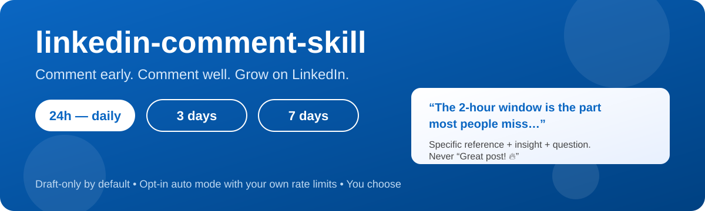
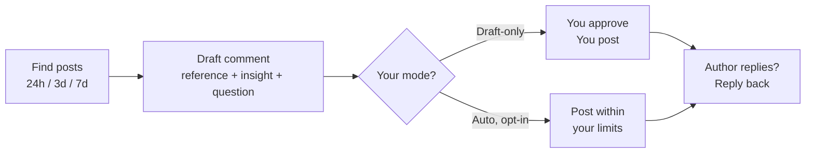

<p align="center">
  
</p>

<div align="center">

# linkedin-comment-skill

**Grow on LinkedIn by commenting well — on posts from the past 24 hours, 3 days, and 7 days.**

Two modes, **your choice**: draft-only (safe) or opt-in auto-posting with **your own rate limits**.

[](https://smabdulmueid97.github.io/linkedin-comment-skill/)
[](https://github.com/smabdulmueid97/linkedin-comment-skill/blob/main/LICENSE)
[](https://github.com/smabdulmueid97/linkedin-comment-skill/stargazers)
[](https://github.com/smabdulmueid97/linkedin-comment-skill/commits/main)

**[▶ Live: https://smabdulmueid97.github.io/linkedin-comment-skill/](https://smabdulmueid97.github.io/linkedin-comment-skill/)**

[Modes](#-two-modes--your-choice) • [Windows](#-the-three-windows) • [Limits](#️-set-your-own-limits) • [Install](#-install--30-seconds) • [Good comment](#-a-good-comment-in-one-line)

</div>

---

## Why this exists

Comments carry far more weight than likes on LinkedIn — and **early comments win**. A comment in the first 30 minutes earns roughly **4× the impressions** of the same comment a day later.

But most comments are generic ("Great post! 🔥"), and LinkedIn now blocks automated slop comments and lets members report them as "Seems like AI slop".

This skill is the version that actually works: specific comments, on the right posts, early — with **you in control of how it runs**.



## ✨ Two modes — your choice

| Mode | What happens | Risk |
|---|---|---|
| **A. Draft-only** *(default, recommended)* | The skill drafts. You read, edit, approve, and post each comment in LinkedIn. | Lowest — AI writing help, human approves every action. |
| **B. Auto-post** *(opt-in)* | The skill posts comments for you, within the limits you set in `templates/config.yaml`. | Higher — LinkedIn bans bots / unauthorised auto-commenting (User Agreement 8.2), accounts risk restriction. You accept that risk by choosing it. |

> The skill **never switches modes on its own**. Draft is the default. Auto only runs when you explicitly choose it.

## ⏱️ Set your own limits

Limits live in [`templates/config.yaml`](templates/config.yaml) — edit the numbers, or just say them in the prompt ("3 comments per hour").

```yaml
mode: draft  # draft | auto
limits:
  comments_per_hour: 3
  comments_per_day: 10
  min_delay_seconds_between_comments: 1200  # 20 minutes
```

| Preset | Per hour | Per day | Delay |
|---|---|---|---|
| Cautious | 1 | 5 | 20 min |
| **Standard** *(default)* | **3** | **10** | **20 min** |
| Aggressive | 5 | 20 | 12 min |

When a cap is hit, the run **stops** — it doesn't queue the rest for later. It also stops immediately on any LinkedIn warning or restriction notice.

## 🕐 The three windows

| Window | When | Rule |
|---|---|---|
| **Past 24h** | Daily | Highest priority. Comment within the first 2 hours where possible, 5–10 posts a day. |
| **Past 3 days** | Every 3 days | Only if the thread is still alive or the post is evergreen. |
| **Past 7 days** | Weekly | Only for key authors or evergreen posts. A dead post is worth nothing — skip it. |

## 🚀 Install — 30 seconds

```bash
git clone https://github.com/smabdulmueid97/linkedin-comment-skill.git
./install.sh
# copies this skill to ~/.claude/skills/linkedin-comment-skill/
```

Or manually: copy `SKILL.md` to `~/.claude/skills/linkedin-comment-skill/SKILL.md`.

## 💬 Use it

```
comment on LinkedIn posts from the past 24 hours in AI engineering and freelancing
run the 3-day sweep — what did I miss that's still alive?
auto-post, 3 comments per hour, max 10 today
```

Before the first run, set your 2–3 topic pillars and your 20–30 target accounts (see [`templates/daily-plan.md`](templates/daily-plan.md)). The skill will ask if they're missing.

## ✍️ A good comment, in one line

**Specific reference + one insight the post didn't cover + one genuine question.** 15–40 words for a reply, 50–200 for a value-add comment. Never under 15 words.

<table>
<tr><th>❌ Don't write this</th><th>✅ Write this instead</th></tr>
<tr>
<td>"Great post! 🔥"</td>
<td>"The 2-hour window is the part most people miss. I commented 3 days late once and it got 12 impressions; the same comment early got 2,000. Do you check the thread before you comment, or just the post?"</td>
</tr>
</table>

## 🗂️ Layout

```
assets/banner.svg               # hero banner above
SKILL.md                        # the skill — both modes + limits
templates/config.yaml           # mode + rate limits (edit me)
templates/daily-plan.md         # pillars, targets, routine
templates/comment-queue.csv     # 24h / 3d / 7d queue tracker
install.sh                      # copies the skill to ~/.claude/skills/
```

## License

MIT
